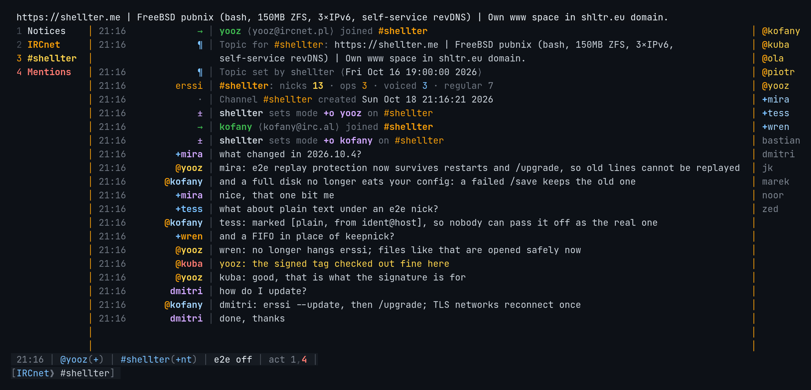

# erssi Shellter Edition

**Your shell, your shelter — on IRCnet.**

[](https://github.com/y-o-o-z/erssi/commits/main)
[](https://github.com/y-o-o-z/erssi/releases)
[](https://github.com/erssi-org/erssi)
[](https://github.com/irssi/irssi)
[](COPYING)

erssi Shellter Edition is an edition of
[erssi](https://github.com/erssi-org/erssi), the modern irssi created by
Jerzy “kofany” Dąbrowski and the erssi-org team. It keeps everything erssi
brings — sidepanels, mouse support, 24-bit colour, image preview, a web
frontend and full irssi Perl script compatibility — and tunes it for people
who live on IRCnet: a polished default theme, help for every command, a
built-in Mentions window, end-to-end encryption, a signed installer that
also updates, and a security review of the parts that face the network.



## Install

One command, no root, about two minutes on a shell box:

```sh
curl -fsSL https://raw.githubusercontent.com/y-o-o-z/erssi/main/shellter-install.sh | sh
```

The installer checks the system first. Run as **root**, it lists the
packages erssi needs (required and recommended, named for apt, dnf, apk,
pacman, zypper or FreeBSD pkg) and installs them once you confirm (`--yes`
skips the question; root must use its own home - `sudo -i` or `su -`). On
a **user account** it lists the missing packages with the command to give
the administrator. There a missing `meson` or `ninja` is installed for you,
only the tool that is missing, from a ready-made Python wheel into a venv
next to the source directory (`~/.local/src/erssi.venv`; this needs
python3). Where there is no wheel for the system - ninja on FreeBSD - the
installer stops and names the package to ask for (`pkg install ninja`).

It then builds the newest release recorded in the installer, only if its
tag points to the recorded commit and carries a valid signature by the
release key (checked with git 2.34+ and ssh-keygen; without them the
installer warns and checks the commit only), runs the test suite and
installs to `~/.local/opt/erssi`, linked as `~/.local/bin/erssi`. Every step
is one line; the build output goes to `~/.local/state/erssi/install.log`,
shown when a step fails. Works on Linux and FreeBSD.

Options: `--prefix`, `--ref <tag|branch|commit>` (anything that is not a
recorded release is built with a warning; a commit as the full SHA),
`--no-test`, `--clean` (remove the build directory afterwards, for small
disk quotas), `--yes`. The source directory (`--src`, default
`~/.local/src/erssi`) and its venv must be yours, and every directory above
them yours or root's. In a rootless container or another user namespace see
`sh shellter-install.sh --help` (`SHELLTER_INSTALL_TRUST_OVERFLOW_UID`).

**FreeBSD** — 2026.10.0 builds with no warnings and passes its test suite
on FreeBSD 14.5, with the OpenSSL of the base system. Packages:
`pkg install git glib pkgconf perl5 python3 ninja` (and `meson`, or let the
installer put it into its venv). Capsicum capability mode works:
`/capsicum enter`, after which erssi can only open files in its irclogs
directory (`capsicum_irclogs_path`, `~/irclogs`).

### Update

```sh
erssi --check-update     # is a newer release available?
erssi --update           # build and install it
```

`erssi --update` runs the installer shipped with the installed release: it
takes the newest release on GitHub that carries a valid signature by the key
of that installer (a tag pushed by anyone else is skipped), builds, tests
and installs it into the same prefix, with the settings of the first install.
A release of the installed version published again with changes (its
signed tag moved to a new commit) counts as an update too. Nothing is built
when erssi is up to date. In a running erssi, `/upgrade` then loads the new
version without disconnecting.

Releases are signed with an SSH key (ED25519,
`SHA256:hF7dvX7vdTfqEsC9LHeujMoHf4NhWdqeBCvN6jXEDAw`, public key in
[`utils/allowed_signers`](utils/allowed_signers)). To check a release by
hand, in a clone:
`git -c gpg.ssh.allowedSignersFile=utils/allowed_signers verify-tag shellter-v2026.10.0`.

erssi keeps its configuration in `~/.erssi/`, so it runs side by side with
irssi. Start it inside tmux so the session survives logging out.

The themes and the `startup` file erssi copies into `~/.erssi/` are updated
with erssi, like the configuration files of a system package: a copy you
have not changed is replaced by the new version on the next start; a copy
you changed (also by `/save -formats`) is never touched, and erssi says once
where the new version is. The sha256 of what erssi installed is kept in
`~/.erssi/default-files.sha256`. Symbolic links are left alone.

### Upgrading from 1.3.x

`erssi --update` on 1.3.10 finds 2026.10.0. Your `~/.erssi/config` is
kept; at the first start erssi adds what changed, once:

- **The Shellter look stays.** Up to 1.3.10 it was built into erssi; now it
  comes from the default config of a new home. Your config gets the former
  values (theme, nick and rank colours, hilight colours, WHOIS in the
  network window, the join count line, 24-bit colours) written into it for
  every setting it does not set yet, so nothing you see changes. Settings
  you set yourself are not touched. erssi says so in one line after the
  banner.
- **E2E statusbar item.** If your info bar is still the one erssi shipped,
  it gets the `e2e` item after `window`. A bar you changed keeps its items:
  `/statusbar additem -after window e2e info`.
- **mentions.pl is built in now.** Its settings (`mentions_window`,
  `mentions_log`, `mentions_log_file`) move to the built-in Mentions
  window, and if the script was in `scripts/autorun` the log stays on.
  Loading the script only unloads it again with a notice; remove
  `~/.erssi/scripts/autorun/mentions.pl` to stop it.
- **Desktop notifications** (new) are off in an existing config:
  `/set term_notify auto` turns them on. The same goes for the Mentions
  log if you did not use mentions.pl: `/set mentions_log on`.
- **E2E with several networks:** keys are now kept per network, and an old
  key of a channel or query is blocked until `/e2e adopt` binds it to one
  network (see [End-to-end encryption](#end-to-end-encryption)).

<details>
<summary>Manual build</summary>

Debian / Ubuntu:

```sh
sudo apt install git gcc meson ninja-build pkgconf libglib2.0-dev libssl-dev \
  libperl-dev libutf8proc-dev libgcrypt20-dev libotr5-dev \
  libcurl4-openssl-dev libchafa-dev
```

FreeBSD (OpenSSL comes from the base system):
`pkg install git meson ninja pkgconf glib perl5 utf8proc libgcrypt libotr curl chafa`

```sh
git clone https://github.com/y-o-o-z/erssi.git && cd erssi
meson setup Build -Dprefix="$HOME/.local/opt/erssi" -Dwith-proxy=yes
ninja -C Build && meson test -C Build && ninja -C Build install
```

GLib (2.32 or newer) and OpenSSL are required, and Perl to build (the
build generates sources with it). Perl scripting (libperl), utf8proc,
libcurl + chafa (image preview) and libotr + libgcrypt (OTR) are detected
and used when present. For a system-wide install use
`-Dprefix=/usr/local` and `sudo ninja -C Build install`.
</details>

## Version

| Component | Version |
|---|---|
| **erssi Shellter Edition 2026.10.0** | erssi 1.3.1 (erssi-org, 2026-04-06) with the changes below. Versions are calendar versions YEAR.MONTH.PATCH (2026.10.0 is the first; 1.3.2 to 1.3.10 came before). Release notes: [NEWS](NEWS). |
| **irssi core** | irssi 1.4.5 plus later changes from irssi `master`, as merged by erssi-org. |
| **Perl scripts** | `Irssi::version()` returns the release date, so scripts that require irssi 1.4.5 or newer load. `$J` is erssi Shellter Edition's own calendar version (`2026.10.0`). |

## What this edition adds

### Mentions, notifications and search (new in 2026.10.0)

- **Mentions window** — private messages and `/me` actions, notices from
  people, DCC CHAT and channel hilights collected in one background window
  (`/mentions`), mirrored to a log file only you can read (`mentions_log`,
  on by default in a new home). `/ignore` is respected, and
  `mentions_exclude_networks` leaves networks out. Built in: no script to
  load. `/help mentions`.
- **Desktop notifications** — a mention while the terminal is not focused
  pops up a notification through the terminal (iTerm2, kitty, WezTerm,
  Ghostty, foot; also inside tmux). `term_notify` is `auto` in a new home;
  in a config from 1.3.x turn it on with `/set term_notify auto`.
  `/set term_notify_text off` leaves the message text out. `/help term_notify`.
- **Search the logs** — `/search needle` looks through the autolog files
  of the channel or query you are in (autolog is on in a new home; if yours
  is off, `/set autolog on`); `-target`, `-network` and `-all` widen it,
  `-regexp` and `-case` change the match, `-max` sets the number of hits
  (50). It runs in a separate process, so erssi goes on meanwhile
  (`/search -stop` ends it), and stops at `search_max_size` (512 MiB) read.
  `/help search`.

### Look and feel

- **`shellter` theme by default** — a dark theme in the colours of
  [shellter.me](https://shellter.me). Messages, events, server replies,
  WHOIS, notices and private messages share one column and one separator,
  so text always starts in the same place and wrapped lines continue under
  it. Joining a channel prints one summary line
  (`#chan: nicks 70 · ops 29 · voiced 4 · regular 37`) instead of a nick table.
  For terminals with a light background there is `shellter-light`, the same
  layout in light colours with every text colour at 4.5:1 or more on white
  ([screenshot](docs/images/erssi-shellter-light.png)): `/set theme shellter-light`,
  with the matching nick colours listed at the top of `themes/shellter-light.theme`.
- **Rank colours** — `$nickmode` and `nick_mode_color_*` draw `@`, `+`, `%`
  and `~`/`&` in their own colours in messages and in the nick list;
  `nick_hash_colors` accepts 24-bit colours.
- **Read marker in the column** — the bundled trackbar branches off the
  separator (`├────`) instead of cutting through timestamps and nicks.
- **Activity that means something** — a quit or nick change marks only the
  windows where that nick is, not every window of the network.
- **Clean windows** — network windows open without `/WINDOW` chatter and
  without server tags on every line; WHOIS replies go to the network window
  (`print_whois_rpl_in_server_window`), not into the channel you are reading.
- **Themeable statusbar** — the colours of the statusbar items (time,
  nick, window, activity, lag, prompt) come from the theme (`sb_*`
  abstracts), with one continuous bar background.
- **Every terminal** — 24-bit colour where the terminal shows it, the
  nearest 256-colour entry where it does not (GNU Screen, Linux console,
  rxvt-unicode, 8/16-colour terminals). `/set term_truecolor auto|on|off`
  overrides it.

### Help for every command

`/help` covers every command, including the erssi commands that had no help
(`credential`, `fe_web`, `floodnet`, `foreach`, `image`, `nickhash`, …) and
the commands of the bundled scripts.
`/help $nickmode` shows the help of an expando.
Help files in `~/.erssi/help/` are read first — drop in a file named after a
command to document your own scripts.

### Bundled scripts

Installed in `<prefix>/share/irssi/scripts` next to the scripts erssi ships,
loaded on demand (`/script load <name>`, or a symlink in
`~/.erssi/scripts/autorun/`).

| Script | What it does |
|---|---|
| `trackbar.pl` | The read marker of trackbar 2.9.2, drawn as `├────` from the theme's separator column when the theme has one. `/mark`, `/trackbar`. |
| `webjournal.pl` | Journals every window to `~/.erssi/journal` (one JSON line per message, files only you can read), for a web client that reads the journal to show history after a restart. |
| `mentions.pl` | Only a stub now: the Mentions window is built in. Loading it moves its settings to the built-in ones and unloads it; remove it from `~/.erssi/scripts/autorun/`. |

### Reliability

- **Anti-floodnet without collateral damage** — counts different senders,
  so one person pasting lines is no longer a flood; never filters people you
  have a query with; ends protection on its own; bounded memory; no crash on
  messages from servers.
- **Sidepanels** — turning a panel off or changing its width gives the space
  back; a terminal narrower than the panels (a phone over ssh) keeps a
  usable window; stale scroll arrows, a leak on every panel hide and a crash
  path on very tall terminals are fixed.
- **Input line** — control characters (bold, colour) are visible and the
  cursor stays on the text.
- **Message formats** — messages to `@#channel` show the right nick.
- **Slow web clients** — output to a web client that reads slowly (a
  phone on mobile data, a large state dump) is queued in order instead of
  dropped; a client that never reads is disconnected at 32 MB.
- **FreeBSD** — tested on FreeBSD 14.5: builds with the base system's
  OpenSSL and passes the test suite; `/connect` works inside Capsicum
  capability mode (`/search` does not run there).

### Security

The network-facing parts were reviewed, fuzzed and tested under
sanitizers.

- **Web frontend (fe-web)** — built for a shared shell box: the password
  travels in an `Authorization` header, never in a URL; one guess per
  connection, compared in constant time; after 5 wrong passwords from one
  peer (a uid on the Unix socket, an address on TCP) that peer gets one
  check every 2 s, while your own uid and peers that logged in before are
  never held up, so nobody else on the box can lock you out; 16 KB and
  10 seconds to log in, with a separate limit for connections still logging
  in; at most 16 clients; oversized frames and oversized or fragmented
  control frames refused. The TLS certificate is kept in
  `~/.erssi/fe-web-cert.pem`, so a web client can pin exactly that
  certificate and nothing else listening on the port can receive the
  password. The key is made only once fe-web is enabled, kept at mode 0600
  and replaced if anyone else could read it. Web connections are not
  inherited by programs that scripts start.
- **Image preview** — http and https only, public addresses only (also after
  redirects), a hard size limit, and no decoding of images too large to
  handle safely. The debug log of clicked URLs is off by default.
- **Configuration** — `~/.erssi/config` is written readable only by you.
- **Hardened build** — by default: PIE, stack protector, stack clash
  protection, `FORTIFY_SOURCE=2`, full RELRO.
- **Tested the hard way** — everything fe-web reads from the network (the
  login request, WebSocket frames, encrypted frames, client messages, IRC
  lines turned into web events) is fuzzed with libFuzzer under AddressSanitizer
  and UndefinedBehaviorSanitizer; every finding is replayed by `meson test`.
  The test suite also runs under both sanitizers.
- **Credential encryption** — switched off: in erssi 1.3.1 it never
  encrypted the configuration file and a wrong master password could delete
  stored credentials. Existing setups keep working; `/help credential`
  explains how to return to plain storage.

## Configuration

The first start in a new home, on a terminal, asks a few questions before
the screen opens: a network (or none; the chosen one connects at every
start), your nick, a SASL account when that network has TLS with a verified
certificate, and the theme. Enter keeps the default shown in brackets. The
answers go to `~/.erssi/config` (mode 0600; a SASL password is stored there
in plain text, as with `/network add -sasl_password`). `n`, Ctrl-D or five
minutes without an answer skip the questions; Ctrl-C quits without saving.
`erssi --setup` asks again, also with an existing config, and only adds to
it (without a terminal it says so and exits). Nothing is asked without a
terminal, with `TERM=dumb`, or with `--config`, `--connect`, `--noconnect`
or `--nick`. While the nick is still `erssi_user`, every start reminds you
after the banner. Ctrl-Z at the password prompt suspends erssi; after `fg`
the prompt is shown again.

```
/set theme shellter                       # the default
/set nick_mode_color_voice %Z79C0FF%_     # rank colours: _owner, _op, _halfop, _voice, _normal
/set print_whois_rpl_in_server_window on  # off: WHOIS in the active window
/set anti_floodnet_notices off            # hide Anti-Floodnet notices
/set term_truecolor auto                  # on / off to override terminal detection
/set term_notify auto                     # desktop notifications (off in a config from 1.3.x)
/set mentions_log on                      # log of the Mentions window
```

The Shellter look (theme, nick and rank colours, WHOIS in the network
window, the join count line, 24-bit colours) comes from the default config
(`irssi.conf`) of a new `~/.erssi`. `/set -default <name>` (and `/reset`)
gives erssi's built-in value.

In tmux, enable RGB colour with `set -as terminal-features ',*:RGB'`, and for
notifications `set -g focus-events on` and `set -g allow-passthrough on`.

## Web client

fe-web lets a web client show the same erssi session in a browser, with
every command executed by erssi;
[NexusIRC](https://github.com/kofany/nexus) by kofany is one.

```
/set fe_web_password <long random secret>
/set fe_web_bind 127.0.0.1
/set fe_web_enabled on
/save
```

On a shared box, erssi can listen on a Unix socket instead of the loopback
port, which every user of the box can connect to (the web client has to
support connecting to a socket):

```
/set fe_web_socket ~/.erssi/fe-web.sock
```

The socket is readable and writable only by you (0600, in a directory only
you can write to) and connections from other users' processes are refused;
TLS and the password work as on TCP. `/help fe_web` has the details; the
E2E part of the protocol is in [docs/fe-web-e2e.md](docs/fe-web-e2e.md).

Keep fe-web on `127.0.0.1`; expose only the web client, behind TLS.

## End-to-end encryption

erssi speaks RPE2E v1.0, the end-to-end encryption of
[repartee](https://github.com/outragedevs/repartee), natively: the `e2e`
module is built in and loaded at start (`-Dwith-e2e=no` leaves it out).
`/e2e on` in a channel or query encrypts it (XChaCha20-Poly1305,
per-sender keys, CTCP key exchange), wire-compatible with repartee and
its WeeChat (`rpe2e.py`) and irssi (`rpe2e.pl`) scripts. A key request
waits for `/e2e accept` (`/e2e pending` lists them), and your key goes
only to people you accepted. Keys are kept per network, so `#test` on two
networks has two keys. The `e2e` statusbar item shows the state of the
active channel or query. `/help e2e` has the commands.

Moving from `rpe2e.pl`: unload the script (`/script unload rpe2e`, and
remove it from `scripts/autorun`); while it is loaded the module stays
inactive. The keyring is the same file (`~/.erssi/rpe2e/keyring.json`),
so there are no new keys; people asking for your key again need one
`/e2e accept`. If you use more than one network, the old keys stay blocked
(nothing is sent or decrypted with them) until `/e2e adopt` in that
channel or query binds them to its network, or `/e2e off` turns E2E off
there. [contrib/rpe2e](contrib/rpe2e/README.md) holds
`rpe2e-from-repartee`, which moves an existing repartee identity, so peers
see no key change.

## Development

```sh
meson setup Build
meson test -C Build                               # unit tests and fuzz corpus replays
meson setup Build-asan -Db_sanitize=address,undefined -Db_lundef=false
meson test -C Build-asan                          # the same tests under ASan and UBSan
```

Tests run with `HOME` inside the build directory, so building and testing
never writes into your own `~/.erssi`. Changes are kept in topic commits
that explain the problem they solve, so upstream merges stay reviewable.
`utils/pre-push` is the maintainer's release hook (it enforces the
maintainer's authorship and signing rules); contributors do not need it.

Most fixes are offered to erssi-org as pull requests (#3 to #11);
[docs/UPSTREAM.md](docs/UPSTREAM.md) lists them.

### Continuous integration

Every commit on `main`, every release tag and the branches of the
maintainer's pull requests are built and tested on the maintainer's own
server: the hardened build with `meson test`, the ASan/UBSan build, live
E2E interop with `rpe2e.pl`, libFuzzer runs on the fe-web and E2E parsers,
the installer test and shellcheck. Each job is a commit status (the check
mark next to a commit) with a one-line result. Pull requests from
other contributors are tested after the maintainer has reviewed them.

`.github/workflows/shellter-ci.yml` describes the same jobs for GitHub
Actions, which stay switched off on this repository.

## Credits and license

- **erssi** — Jerzy “kofany” Dąbrowski and the erssi-org team,
  [erssi-org/erssi](https://github.com/erssi-org/erssi).
- **irssi** — the irssi developers, [irssi.org](https://irssi.org).
- **RPE2E** — the repartee authors (MIT, [contrib/rpe2e/LICENSE](contrib/rpe2e/LICENSE)).
- **Shellter Edition** — y-o-o-z, [y-o-o-z/erssi](https://github.com/y-o-o-z/erssi).

GPL-2.0-or-later, like irssi and erssi. The e2e module is a port of the
MIT-licensed `rpe2e.pl` (licence in `contrib/rpe2e/LICENSE`).
